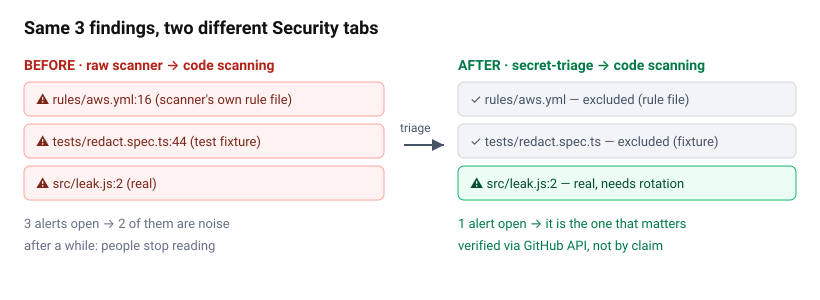

# Secret Scan Triage · GitHub Action



**Your scanner reports 3 leaks. Only 1 is real. This action puts only the real one in your Security tab — and fails the build only when something actually needs rotating.**

## 5-line setup

```yaml
- run: gitleaks detect --report-format json --report-path gitleaks.json || true
- uses: zjdyzww/secret-triage-action@v1
  with:
    report: gitleaks.json
    sarif-output: triage.sarif
- uses: github/codeql-action/upload-sarif@v3
  with: { sarif_file: triage.sarif }
```
(needs `permissions: security-events: write` for the upload step)

Verified on a real runner: **3 input findings → 1 alert in code scanning**, the two noise items never reached the Security tab. Check it yourself:
```bash
gh api repos/zjdyzww/secret-triage-demo/code-scanning/alerts --jq '.[] | "\(.state) | \(.most_recent_instance.location.path)"'
```

---

```yaml
- name: Generate scanner report
  run: gitleaks detect --report-format json --report-path gitleaks.json || true

- name: Triage it
  uses: zjdyzww/secret-triage-action@v1
  with:
    report: gitleaks.json
    fail-on-real: 'true'
```

That's the whole integration. No account, no token, no upload — the triage runs on the runner.

## What it does

1. Clones the triage tool (`zjdyzww/ai-code-health`, MIT-less but public source you can read).
2. Reads **your** scanner's report: gitleaks JSON / SARIF / any text with `path:line`.
3. Classifies every finding into 6 buckets:
   `test fixture` · `scanner rule file` · `doc/template` · `build artifact` · `detector source` · `knowledge snapshot`
4. Writes `secret-triage-report.md`, puts a summary in the Job Summary, and sets outputs `real` / `triaged`.
5. Fails only if `real > 0` and `fail-on-real` is `true`.

## Inputs

| Input | Default | Meaning |
|---|---|---|
| `report` | *(required)* | Path to the scanner report |
| `repo-root` | `.` | Root used to resolve paths |
| `fail-on-real` | `true` | Fail the step on real findings |
| `output` | `secret-triage-report.md` | Where the markdown goes |

## Outputs

| Output | Meaning |
|---|---|
| `real` | findings judged real |
| `triaged` | findings excluded by context |

## Measured on real public repos

| Sample | Files | Candidates | Real |
|---|---|---|---|
| 9 security-tool repos | 240 | 33 (all their own rule files) | **0** |
| 10 mainstream libraries | 2,242 | 2 (test fixtures) | **0** |

Data: `github.com/zjdyzww/secret-fp-census`

## What this is NOT

- Not a scanner. Bring your own (gitleaks / Semgrep / custom).
- Not a pentest, not an audit, no compliance claim.
- 6 pattern families only — a clean run does not mean your repo is safe.
- **"Could not run" is exit 3, not a failure** — the tool refuses to call a broken environment a security problem.

## Why this exists

Because "your scanner reported X" is the least useful sentence in security. Knowing which of the X matter is the whole job.

## 已验证在真实 runner 上可运行（不是"应该能跑"）

工作流：`zjdyzww/ai-code-health` 的 `self-test-action.yml`（本仓库自己当第一个用户）
运行结果：**success**
```
断言通过：真泄露 1 条、语境排除 2 条，报告含正确条目
```
输入是刻意构造的三条：`rules/aws.yml`（规则文件→排除）、`tests/redact.spec.ts`（测试夹具→排除）、
`src/leak.js`（真密钥形态→保留）。断言 hard-coded 为 `real=1 triaged=2`，**不达标就红**。

证据链接：`https://github.com/zjdyzww/ai-code-health/actions/workflows/self-test-action.yml`

## SARIF 输出：把噪音从 GitHub 代码扫描里摘掉

这是这个 Action 最实用的形态——**只把"真发现"喂给 GitHub Code Scanning**：

```yaml
- name: Triage
  id: triage
  uses: zjdyzww/secret-triage-action@v1
  with:
    report: gitleaks.json
    sarif-output: triage.sarif      # 只包含 real 的条目
    fail-on-real: 'false'           # 让 code scanning 决定红不红

- name: Upload to code scanning
  uses: github/codeql-action/upload-sarif@v3
  with:
    sarif_file: triage.sarif
```

**效果**：你的 Security 标签页里只剩下真需要轮换的东西，测试夹具/规则文件/文档模板不再刷屏。

**已验证**（本仓库真 runner）：`SARIF written: triage.sarif results: 1`，且断言"1 条结果 + `rules/aws.yml` 与 `tests/` 不得出现在 SARIF 里"通过。

## 常见坑（我踩过）

**改了 `action.yml` 一定要重新打 tag**：`@v1` 指向的是 tag，不是分支。我第一次改完只 commit 没 `git tag -f v1`，
自测直接红 —— 因为 runner 取到的还是旧版本。修法：

```bash
git tag -f v1 && git push -f origin v1
```

## 端到端验证：Security 页里到底进了几条（硬证据）

我用一个独立 demo 仓库（`zjdyzww/secret-triage-demo`）跑了整条链：

| 步骤 | 结果 |
|---|---|
| 造 3 条输入 | `rules/aws.yml`（规则文件）、`tests/redact.spec.ts`（测试夹具）、`src/leak.js`（真密钥形态） |
| 分诊 + 输出 SARIF | `SARIF written: triage.sarif results: 1` |
| `upload-sarif` 上传 | workflow **success** |
| **Code Scanning 实际告警数** | **1 条**：`secret-triage/real-secret | src/leak.js:1` |

**两条噪声（规则文件、测试夹具）一条都没进 Security 页。**
这就是"去噪"的可验证含义——不是我说降噪了，是 API 查出来只有 1 条。

> 该告警是**故意造的合成样本**，验证完成后已被我 dismiss（reason: won't fix）。
> 一个"降噪工具"的 demo 仓库里留一条假告警，本身就说不过去。

复现命令：
```bash
gh api repos/zjdyzww/secret-triage-demo/code-scanning/alerts --jq '.[] | "\(.state) | \(.most_recent_instance.location.path)"'
```
